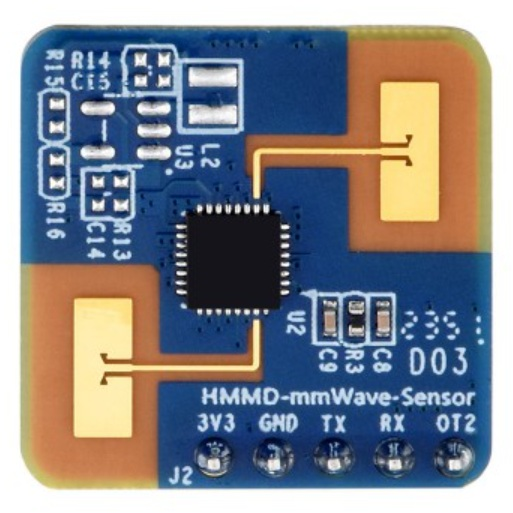
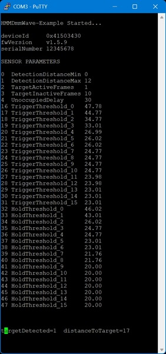

# Arduino library for WaveShare HMMD 24GHz mmWave Sensor

This WaveShare HMMD module looks exactly the same as HLK-LD2410x mmWave modules, but it has a yet another slightly different protocol. You cannot use the LD2410 libraries with this module.



The WaveShare Wiki describes everything, including the Windows application for configuration, which was written by the S3KM1110 mmWave chip manufacturer (ICLEGEND). \
https://www.waveshare.com/wiki/HMMD_mmWave_Sensor

> [!TIP]
> In fact, there is no need to use this library for configuring the HMMD module, just use the WaveShare Windows application. Use this library only if you don't have a USB-to-TTL adapter, or for polling the radar reports, or just for experimentation.

> [!CAUTION]
> If you use their Windows application, always use the WaveShare USB-to-TTL adapter because this provides the necessary 3.3V for the sensor board. IT WILL NOT RUN ON 5V! \
> Most other USB-to-TTL adapters provide VCC at 5V, directly from the USB power, even if they are the 3.3V versions! **BANG!** \
> I made an adapter with a 3.3V regulator to provide the 3.3V for the WaveShare board.


## Installing the Library

Download the latest ZIP file with green button on this library's Github screen, "<> Code / Download Zip". This downloads a file called "LD2410mmWave-main.zip" into your Downloads directory.

**To install the ZIP file with the Arduino IDE** \
Select menu item "Sketch / Include Library > Add ZIP Library...". This opens the "Select ZIP File" window. Open the Downloads directory and choose the "LD2410mmWave-main.zip" file you just downloaded. You should see a "Successfully installed library" message. \
To open the example sketch, select menu item "File > Examples" and scroll down beyond "Examples from Custom Libraries" and choose the "LD2410mmWave > LD2410mmWave-Example" entry. This opens the "LD2410mmWave-Example.ino" example sketch in a new Arduino IDE window.


## Class Reference

This provides an overview of the library.

For details of each method, refer to the comments in the source code, [src/HMMDmmWave.h](src/LHMMDmmWave.h).

The library is in a single include file, not separate `.h` and `.cpp` files. This is fine if you want to access the class from a single source file, which is the usual case. If you need to access it from more than one source file, then move the code into a `.cpp` file.

```cpp
class HMMDmmWave
{
public:
    // Data returned by radar report message
    struct RadarData
    {
        bool targetDetected;
        uint distanceToTarget;
        uint distanceGateEnergy[16];
    };

    // Operating Modes
    enum Mode : uint
    {
        Normal = 0x64,      // Normal mode, outputs text "Range <n>\r\nON|OFF\r\n"
        Debug = 0x00,       // Debug mode, outputs undocumented data
        Report = 0x04       // Report mode, outputs binary RadarData structures
    };

    bool begin(Stream* stream);
    bool setMode(Mode mode);
    bool enableConfigurationCommands();
    bool disableConfigurationCommands();
    bool getFirmwareVersion(char* fwVersion /*6 chars + NUL*/);
    bool getSerialNumber(char* serialNumber /*8 chars + NUL*/);
    bool setSerialNumber(const char* serialNumber /*8 chars*/);
    bool getDeviceId(ulong* deviceId);
    bool receive(RadarData* data = NULL);
    //bool receiveDebugFrame(Stream* stream, byte* buf, uint bufLength, uint* frameLength);

    #ifdef HMMD_ENABLE_CONFIG

    // Configuration Parameter Numbers, for read/writeParameter();
    enum Param : uint
    {
        // Integer values
        DetectionDistanceMin = 0,
        DetectionDistanceMax = 1,
        TargetActiveFrames = 2,
        TargetInactiveFrames = 3,
        UnoccupiedDelay = 4,
        // Float values are stored in integer log format,
        // see logToFloat() and floatToLog()
        TriggerThreshold = 0x10,    // 16 x 32-bit integer log values, 0x10 .. 0x1F
        HoldThreshold = 0x20        // 16 x 32-bit integer log values, 0x20 .. 0x3F
    };
    bool readParameter(Param param, ulong* data);
    bool writeParameter(Param param, ulong data);

    // The TriggerThreshold and HoldThreshold parameters are floating point 
    // values, but are stored in an "integer log" format, so they must be 
    // converted to/from this format with these methods
    float logToFloat(ulong data) { return data == 0 ? 0.0f : log10f((float)data) * 10.0f; }
    ulong floatToLog(float f)    { return (ulong)(powf(10.0f, f / 10.0f) + 0.5f); }

    #ifdef DEBUG
    bool printParameters();
    bool printIntParam(Param param, const char* name);
    bool printFloatParam(Param param, const char* name);
    void dump(const byte* pb, uint len);
    #endif

    #endif // #ifdef HMMD_ENABLE_CONFIG
};
```


## Example Sketch

The example sketch uses two serial ports. `Serial` for the Serial Monitor output, and `Serial1` for communicating with the mmWave sensor. It shows how to define `Serial1` on several different MCUs.

For MCUs running at less than 120MHz, `Serial1` must be `HardwareSerial` (or `Uart`), because `SoftwareSerial` will not run reliably ate 115200 baud. 

`setup()` initialises the sensor and displays some information from the sensor.

`loop()` polls for radar report messages and displays them on the Serial Monitor. If you are using PuTTy, or a Serial Monitor which supports '\r' (carraige return WITHOUT linefeed), then you will get a nice non-scrolling display. With the Arduino Serial Monitor you will see a scrolling display because this does not support '\r' or any escape sequences.




## References

**WaveShare Wiki for HMMD mmWave Sensor** \
https://www.waveshare.com/wiki/HMMD_mmWave_Sensor

**Other _mumanchu_ mmWave Sensor Libraries**

For LD2410C and LD2410B 24GHz mmWave Sensors \
https://github.com/mumanchu/LD2410mmWave

For Seeed Studio MR24HPC1 25GHz mmWave Sensor \
https://github.com/mumanchu/MR24HPC1mmWave


## Revision History

| Date       | Version  | Notes        |
|:---------- |:---------| :----------- |
| 2026.11.18 | 0.0.0    | Preliminary  |


<br/>


## Joke of the Week 

Did you sleep well?

_Yes, I slept like a baby._

_Woke up ten times in the night screaming for mummy and wet the bed._

